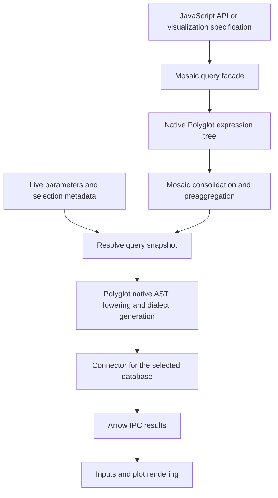

<script setup>
import NativeCompiler from '../../.vitepress/components/NativeCompiler.vue';
</script>

# Native Polyglot SQL architecture

This is the implementation design for replacing Mosaic's SQL AST and SQL renderer
with Polyglot's native expression tree and compiler. The compiler prerequisite is
implemented; the runtime migration and additional backend remain in progress. Execute the [work packets](./work-packets.md) in their
dependency order. The baseline is commit `088a88615a15b4faf5a248d04ed213ea8bad2a3a`.

The destination is one SQL representation, with Mosaic retaining query authoring,
reactivity and interactive optimizations. DuckDB remains the first fully supported
execution backend. PostgreSQL is the first additional execution target; other
dialects remain compiler candidates until exercised against their databases.

The temporary `/native` entry provides the compiler and migrated query path while
the normal SQL entry retains its existing implementation. This example constructs a
native expression tree and compiles it in the browser:

<ClientOnly><NativeCompiler /></ClientOnly>

## Target query path



Mosaic-generated queries never pass through an intermediate DuckDB SQL string and
SQL parser. User-authored SQL still needs parsing at its input boundary. The
visualization AST under `packages/vgplot/spec/src/ast/` and the Python visualization
DSL retain their existing responsibilities; this migration replaces the SQL tree.

## What the analysis established

On 2026-10-24 the repository was reparsed with DuckDB **2.0.0** and the
**Sitting Duck 1.16.0** extension. Queries over `read_ast` output located SQL imports,
class definitions, clause-field access and custom render methods. CodeGraph and
direct source inspection supplied relationships and details beyond those queries.

| Current owner | Behavior that must move |
| --- | --- |
| `packages/mosaic/sql/src/ast/`, `visit/`, `init.ts` | Node hierarchy, traversal, cloning, rewriting and global DuckDB renderer |
| SQL `functions/`, `transforms/`, `load/` | Public authoring semantics and algorithmic query construction |
| `core/src/QueryManager.ts` | Conversion to SQL at submission, caching, in-flight deduplication, cancellation and ordered execution |
| `core/src/QueryConsolidator.ts` | Query-shape analysis and grouped result projections |
| `core/src/preagg/` | Lineage, scoped rewrites, sufficient statistics and materialized preaggregates |
| `core/src/clause/`, SQL `ParamNode` and `ColumnParamNode` | Shared field-node identity, live values and dynamic identifiers |
| `plot/src/transforms/bin.js` | `BinTransformNode` builds its expression lazily from current channel statistics |
| `plot/src/marks/ConnectedMark.js`, `interactors/Highlight.js` | Direct select/group clause inspection |
| `plot/src/interactors/util/get-field.js`, `marks/util/extent.js` | Legacy node tags and class checks |
| `spec/src/ast/ExpressionNode.js`, `WindowFrameNode.js` | Raw SQL with scalar/identifier bindings and SQL frame construction |
| `widget/src/index.js` | Selection predicates serialized separately from ordinary queries |
| `core/src/util/field-info.ts` | DuckDB-shaped description queries and metadata results |

Sitting Duck recovered around valid TypeScript constructs in `ast/join.ts`,
`visit/codegen/duckdb.ts` and `core/src/index.ts`, including contextual `using` and
type exports. These are grammar limitations, not TypeScript defects. An absent
parsed reference does not establish that a file can be deleted. Native typechecks,
module dependency searches and consumer tests are also required.

The structural queries are simple and reusable. For a fresh analysis, materialize
the current tracked source files with `read_ast(paths, context := 'native',
source := 'full')` as `ast`; do not parse dependency directories or Bazel outputs.

```sql
SELECT DISTINCT a.file_path, a.start_line
FROM ast a
JOIN ast b ON a.file_path = b.file_path
 AND b.node_id > a.node_id
 AND b.node_id <= a.node_id + a.descendant_count
WHERE a.type = 'import_statement'
  AND b.type = 'string'
  AND b.peek LIKE '%@uwdata/mosaic-sql%'
ORDER BY 1, 2;

SELECT DISTINCT a.file_path, b.name
FROM ast a
JOIN ast b ON a.file_path = b.file_path
 AND b.node_id > a.node_id
 AND b.node_id <= a.node_id + a.descendant_count
WHERE a.type = 'member_expression'
  AND b.type = 'property_identifier'
  AND b.name IN ('_select', '_from', '_where', '_with', '_groupby',
                 '_having', '_qualify', '_orderby', '_distinct', '_distinctOn')
ORDER BY 1, 2;
```

Temporary analysis databases and probes stay outside the repository. They are
investigation tools, not new build inputs or migration tracking infrastructure.

## Polyglot prerequisite

The inspected published SDK is `@polyglot-sql/sdk` **0.13.4**. Its native data type
is `ast.Expression`, an externally tagged plain-data union. Its current
`generate(ast, target)` API is not equivalent to its SQL transpilation pipeline.
Actual package probes found the following differences:

| Input feature | Direct generation or strict transpilation observation |
| --- | --- |
| DuckDB `strftime` targeting PostgreSQL | `generate` retains `STRFTIME`; transpilation rewrites it to `TO_CHAR` |
| `QUALIFY` targeting PostgreSQL | `generate` can retain an unsupported `QUALIFY` clause |
| Aggregate empty-input behavior targeting ClickHouse | Strict transpilation can reject a semantic mismatch that direct generation reports as successful |
| `GROUP BY ALL`, `COLUMNS()`, `DESCRIBE SELECT`, `TRY_CAST` | Current success diagnostics do not consistently establish target support; a rejected conversion or a tested lowering is needed |
| Timestamp `epoch_ms` targeting PostgreSQL | The published transpiler can choose numeric-to-timestamp instead of timestamp-to-milliseconds |

Consequently P00 must deliver a native **`compileAst`** API in
[our Polyglot fork](https://github.com/venkat-oss/polyglot) before Mosaic migrates.
Compiler gaps are fork implementation work, not a reason to retain Mosaic's AST
or wait for an upstream release. The fork now exports this API. It accepts
native expressions, a source semantic dialect, a target dialect and unsupported
handling options. It must reuse the post-parse worker in Polyglot's
`Dialect::transpile_inner`, including normalization, target transforms and strict
diagnostics. It must not stringify the input and call `transpile` internally.

Use DuckDB as the semantic baseline for existing Mosaic functions during this
migration. That identifies their current meaning; it does not require a DuckDB
engine or intermediate DuckDB SQL. Construct Polyglot's semantic variants rather
than representing every function as an unrecognized generic call.

Mosaic pins the complete SDK archive from private fork revision
`f302b8d7aeb04baca547eb119d105118c70f83c6`, package version 0.13.3, through a
[public Mosaic release](https://github.com/venkat-oss/mosaic/releases/tag/polyglot-sdk-f302b8d7aeb04baca547eb119d105118c70f83c6)
and lockfile integrity. The isolated branch `mosaic-native-ast` starts from
`0b6e35b`; it preserves the fork's Bazel/CUE ownership while incorporating the
native compiler and relevant upstream generator fixes. The separate CUE migration
continues in the original checkout.

The fork's Rust, WASM, SDK and packaged Node/browser tests pass. Supported
portability cases also execute against DuckDB 2.0.0 and PostgreSQL 16. Strict
PostgreSQL compilation rejects unsupported or unresolved operations, including
non-throwing casts, schema-dependent GROUP BY ALL and unresolved epoch_ms
overloads. This establishes the compiler boundary; PostgreSQL execution inside
Mosaic remains P10 work.

## Representation and compatibility decisions

- Preserve high-level SQL helpers and the mutable `Query` facade: builder methods
  return the same handle, and `clone()` creates independently editable query
  state. The handle owns a Polyglot tree, not mirrored legacy clause arrays.
- Preserve aggregate/window chains such as `.where()`, `.distinct()`, `.orderby()`
  and `.over()` through thin handles over native expressions, with their existing
  method/clone behavior. These handles do not recreate the old per-node class
  hierarchy or store parallel names/argument trees.
- Remove the old low-level node constructor hierarchy, renderer visitors and
  custom `toString(visitor)` extension API in a documented breaking release.
  Preserve useful type names as native aliases where accurate. Do not emulate
  legacy `instanceof` behavior with a second node hierarchy.
- Keep live `Param`/`Selection` objects and mark metadata in JavaScript-side
  binding registries. Use reserved native parameter placeholders with stable
  binding IDs, resolving scalar values, identifiers and delayed expressions
  before compilation. Never add arbitrary metadata keys to Polyglot variants.
- Make field/lineage analysis binding-aware. An identifier placeholder is not an
  ordinary column node. Read its binding kind and current identifier for analysis;
  invalidate or recompute identifier-dependent plans when it changes, including
  while queued. Scalar values retain submission-time resolution. Resolve deferred
  bin metadata before analyzing a plan that depends on its fields or statistics.
- Preserve shared node references between selection fields and predicates while
  performing Mosaic rewrites. Clone with a memo and remap binding entries.
  Resolve a submission snapshot before crossing the WASM boundary; returned Rust
  trees do not carry JavaScript identity or live bindings.
- Use native AST walks for identity-sensitive analysis. SDK helpers that cross
  Rust can return copies, and even a no-op SDK `ast.transform` reconstructs nodes.
  Do not use those copies as keys into existing identity-based rewrite maps.
- Keep the execution context per coordinator: dialect, backend and connection
  generation. Switching it cancels outstanding reads and clears result,
  consolidation and preaggregation state. Independent coordinators can target
  different dialects; there is no process-global visitor.

These choices preserve public authoring behavior while explicitly retiring the
compiler extension API. They do not promise source compatibility for consumers
that subclass `ExprNode` or mutate `_select` and other legacy fields. P01 documents
the replacement extension API and migration examples before the first slice.

`LegacyInputAdapter` admits existing field/predicate nodes and simple pilot
SELECT/DESCRIBE queries. Native CTEs, sets, joins, samples and pivots are authored
directly; complex legacy relational queries retain their existing execution path
until their consumers migrate. P09 removes this bounded adapter.

## Raw SQL and compilation boundary

Retain `asNode('x')` as an identifier and `asLiteral('x')` as a value. The `sql`
tag currently interpolates strings as SQL text, not bound string values; preserve
that distinction. Parse complete user-authored statements or expressions with an
explicit source dialect, defaulting existing APIs to DuckDB semantics.

For mixed raw fragments and structured interpolations, construct a template with
reserved scalar/identifier holes, parse it with Polyglot, and replace those holes
with native expressions while retaining live binding IDs. Partial fragments are
assembled at their enclosing expression/statement boundary. A dialect-owned
opaque statement may execute unchanged only against that same declared dialect;
it is not portable or eligible for structural optimizations. Unsupported portable
input fails explicitly, never through a fallback to the retired renderer.

Resolve parameters at submission, matching the current `QueryManager` timing.
Compile each statement in an `exec` batch in order; never keep only the first
element of a compiler result array. Preserve identifier escaping, aliases, literal
dates, non-finite-to-NULL behavior, result columns and Arrow types. SQL whitespace
and equivalent spelling are not compatibility requirements.

## Runtime packaging

Polyglot is a required dependency after the SQL compiler switches, including for
DuckDB users. The published 0.13.4 WASM file is about 23 MB uncompressed and the npm
archive about 5.5 MB; these are observed sizes, not performance targets. Measure
module readiness, transferred bytes and first-query latency on actual package and
widget builds. Do not maintain a second compiler to make this dependency optional.

The P01 SDK archive at `b83718f` is 6.80 MB, its uncompressed WASM 26.35 MB,
and the embedded widget JavaScript bundle 36.72 MB. Local measurements on
2026-10-24 using that revision produced these medians:

| Consumer | Module ready | First compiler call |
| --- | ---: | ---: |
| Installed SQL package, Node 24.22.1 | 88.7 ms | 124.6 ms |
| Browser SDK, Chromium 156 | 101.8 ms | 157.3 ms |
| Actual widget loaded from a blob | 1,145.4 ms | — |
| Widget compiler fixture using the same initializer | 1,353.0 ms | 140.2 ms |

Node used five fresh processes; browser cases used three fresh browsers each,
with warm filesystem caches. Node/browser queries compiled a filtered count/sum;
the widget fixture compiled a scalar predicate. The actual widget's query path
moves in P08, so its first compiler call is measured through that fixture.
Compilation plus the first query against an already initialized DuckDB took
133.3 ms in Node. An uncompressed WASM transfer over loopback HTTP took 67.9 ms;
that does not predict an internet download. Widget timings exclude notebook
transfer and Blob construction. These measurements establish a startup baseline,
not a speedup claim.

Node ESM initializes the published SDK before import completes. Its browser entry
uses top-level await and a sibling WASM URL. Declare the WASM input and output in
Bazel and configure Vite/VitePress to load it. Keep synchronous query authoring
available after module readiness; avoid WASM allocation per expression helper.

The widget is an esbuild ESM bundle that can be loaded from a blob URL. A sibling
`import.meta.url` lookup is insufficient there. Its async initialization must pass
a declared embedded WASM data URL to `await init({ wasmUrl })`. Include the asset
in wheel/sdist outputs. Use one manual runtime entry throughout the bundle so a
root SDK import cannot load a second instance. P01 owns this packaged probe before
runtime migration begins. Do not rely on developer caches, package install
hooks or an unconfigured external CDN to supply the compiler.

## CUE and backend boundaries

CUE continues to own visualization contracts, generated signatures, bindings,
references and starters. SQL runtime construction and interactive algorithms stay
in TypeScript/JavaScript. Do not reproduce Polyglot's AST or dialect function
catalog in CUE. Edit `api/transforms/{column,aggregate,window}` or another owning
family only when its public contract changes, then regenerate normal outputs.

The Python DSL continues to serialize visualization specifications. It does not
gain a Polyglot Python dependency. Widget predicate export must compile with the
same context as normal queries; its Python-side DuckDB path stays DuckDB SQL.

The connector still accepts SQL and returns Arrow IPC or an execution result.
The current Node, Python, Go and Rust servers remain DuckDB backends. Compilation
to PostgreSQL does not make them PostgreSQL servers. P10 adds one Node-only
PostgreSQL execution adapter and tests a real selection/query/result path. A browser
PostgreSQL gateway and distributed federation are separate follow-on work.

DuckDB retains full existing behavior. PostgreSQL starts with explicit support for
scalar/filter/group/order queries, metadata and documented preaggregation behavior.
Other features either have tested lowerings or fail before execution. A dialect
name advertised by Polyglot does not establish complete Mosaic backend support.

## Transition and retirement

Only one internal native pilot path and one one-way legacy-input adapter are
allowed while slices migrate. Native pilot coordinators use native clause
construction and isolated Selection graphs; native fields never reach legacy
clause helpers. The adapter normalizes an explicitly admitted legacy clause once,
using a context-owned memo shared by its fields, predicate and query consumers.
It never converts native queries back to legacy trees or renders/reparses generated
SQL. Existing clients remain on the old path until their slice moves. Native
failures do not retry through the old compiler.

P02 introduces this boundary; later families author native trees directly.
P09 removes the boundary and every legacy SQL representation. P03 enables native
consolidation using structural keys, a shared submission snapshot and captured
SQL/context cache keys. Unsupported grouping shapes use the original native
query. The existing consolidator branch still serves unmigrated clients and is
deleted in P09. Native preaggregation remains P04 work and must be restored
before the default switch.

Per-slice packets identify code to delete immediately and shared code whose final
owner is P09. Keep behavior tests; remove temporary comparisons and tests whose
only purpose was asserting the old representation. Use ordinary source diffs,
Bazel checks and these documents. No receipts, seals, progress registries,
generated migration manifests or additional status systems are needed.

## Sources

- [Polyglot SDK](https://github.com/tobilg/polyglot/blob/main/packages/sdk/README.md)
  and [native dialect compilation](https://github.com/tobilg/polyglot/blob/main/crates/polyglot-sql/src/dialects/mod.rs).
- [Our Polyglot fork](https://github.com/venkat-oss/polyglot), where missing AST
  compilation, lowering and typed factories will be implemented.
- [Sitting Duck](https://github.com/teaguesterling/sitting_duck) for source AST
  analysis; this is distinct from the SQL AST being migrated.
- [Existing build workflow](../build.md) and
  [CUE generation ownership](../../spec-generation/index.md).
